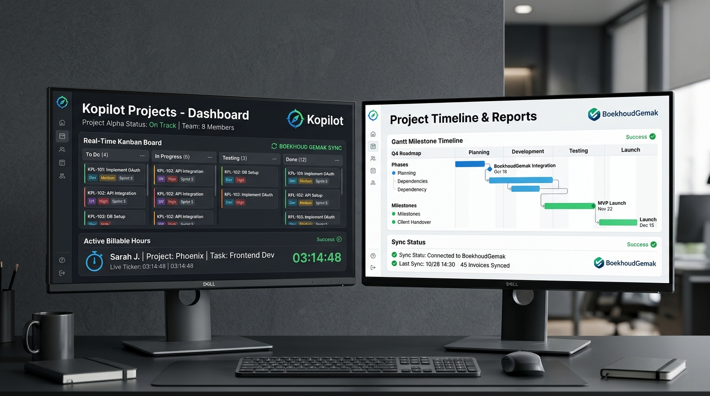

# Kopilot Projects – Collaborative Project Management & BoekhoudGemak Hub



<div align="center">

**[English](#-english) | [Nederlands](#-nederlands)**

[](https://www.paypal.com/donate/?business=luciferamorgenster@gmail.com&no_recurring=0&currency_code=EUR)

</div>

---

## 💖 Support & Sponsor This Project

If you find Kopilot Projects helpful for managing your agile projects, tracking billable time, or synchronizing with your **BoekhoudGemak** accounting application, consider supporting ongoing development:

- **PayPal Account**: [`luciferamorgenster@gmail.com`](mailto:luciferamorgenster@gmail.com)
- **Direct Donation Link**: [**Donate via PayPal to luciferamorgenster@gmail.com**](https://www.paypal.com/donate/?business=luciferamorgenster@gmail.com&no_recurring=0&currency_code=EUR)

Your support helps fund continuous improvements, real-time collaboration updates, and new Dutch accounting integrations!

---

<a name="-english"></a>
## 🇬🇧 English

### Overview
**Kopilot Projects** is an enterprise-grade, responsive, and GDPR/AVG-compliant SaaS project management platform. Designed for agile teams, agencies, and consultancies, it unifies task execution with automated client billing through a direct connection with the **BoekhoudGemak** application in your app list.

### 🌟 Key Features

1. **Direct BoekhoudGemak App Compatibility**:
   - **App-to-App Bridge**: Configure the URL of your BoekhoudGemak application from your app list (e.g. `https://boekhoudgemak.applet.local` or cloud URL) with live connection ping and millisecond latency tracking.
   - **Debtor & Relation Sync**: Pull client debtors directly from your BoekhoudGemak app into your project workspace.
   - **eExact XML Batch Export**: Generate and download standard `eExact XML` files containing sales invoices (*concept verkoopfacturen*), journal codes, ledger accounts (`8000`), and VAT rates ready for drag-and-drop import into BoekhoudGemak.
   - **Direct WebAPI v1 Dispatch**: Push unbilled hours with line items and debtor references straight to the API endpoint.

2. **Real-Time Collaboration & Presence**:
   - Active collaborator cluster showing live peer presence (active, viewing, or editing).
   - Instant in-app notification center with unread counts and sound notifications.

3. **Multi-View Execution**:
   - **Kanban Sprint Board**: 5 columns (*Backlog*, *To Do*, *In Progress*, *Review*, *Done*) with clean unboxed metadata, priority flags, billable tags, and Google Drive links.
   - **Gantt Milestone Timeline**: Multi-week visual schedule with milestone markers, progress completion sliders, and critical delivery paths.
   - **High-Density Task Grid**: Tabular task audit view with multi-field sorting, inline status controls, and CSV export.

4. **Precision Time Tracking & Productivity Analytics**:
   - Persistent digital stopwatch ticker in the navigation bar with start, pause, resume, and stop actions.
   - Weekly 7-day timesheet grid with billable efficiency percentage calculations.
   - Team member utilization reports with individual billable ratios, financial yield in EUR, and CSV datasets.

5. **External Cloud Integrations**:
   - **Slack Webhooks**: Automated broadcast notifications to `#dev-team` or `#billing` when tasks finish, milestones are reached, or invoices are staged.
   - **Google Drive**: Cloud storage meter, file explorer modal, and 1-click attachment of Google Docs, Sheets, and design files to tasks.

6. **GDPR / AVG Compliance**:
   - Granular cookie and privacy consent banner (Strictly Necessary, Analytics, Integrations).
   - **Article 20 Data Portability**: Machine-readable JSON download of all projects, tasks, time entries, and audit logs.
   - **Article 17 Right to Erasure**: Permanent purge routine for local workspace data.
   - European DPA compliance and TLS 1.3 encryption documentation.

7. **Multilingual & Dual-Theme UI**:
   - English default with instant toggle to Dutch (Nederlands).
   - Clean dark and light mode built with Tailwind CSS v4 `@custom-variant dark`.

### Quick Start

```bash
# Clone the repository
git clone <repo-url>
cd kopilot-projects

# Install dependencies
npm install

# Start development server on port 3000
npm run dev
```

---

<a name="-nederlands"></a>
## 🇳🇱 Nederlands

### Overzicht
**Kopilot Projects** is een modern, AVG-conform projectbeheerplatform met realtime samenwerking, gedetailleerde tijdregistratie en een directe koppeling met de **BoekhoudGemak** applicatie uit uw app-lijst.

### 🌟 Belangrijkste Functionaliteiten

1. **Compatibiliteit met BoekhoudGemak App**:
   - **App-naar-App Koppeling**: Koppel rechtstreeks met uw BoekhoudGemak applicatie via het App-to-App protocol. Voer eenvoudig de URL in en test de verbinding direct via de ping-functie.
   - **eExact XML Export**: Genereer met één klik een officieel `eExact XML` bestand voor directe import in uw BoekhoudGemak app (inclusief debiteurcodes, omzetrekening `8000`, uursoort `UUR-DEV` en btw).
   - **Debiteuren Synchronisatie**: Haal automatisch debiteuren op uit BoekhoudGemak en koppel ze aan uw projecten.
   - **Concept Verkoopfacturen**: Bundel openstaande declarabele uren automatisch tot concept facturen.

2. **Realtime Samenwerking & Aanwezigheid**:
   - Live teamledenindicator: zie in één oogopslag wie actief is, wie kaarten bewerkt en wie tijd registreert.
   - Geautomatiseerde notificaties bij voltooide taken, behaalde mijlpalen en factuurbatches.

3. **Flexibele Weergaven**:
   - **Kanban Sprintbord**: 5 kolommen (*Backlog*, *Te Doen*, *In Behandeling*, *In Review*, *Afgerond*) met overzichtelijke typografie en statusknoppen.
   - **Gantt Tijdlijn**: Meerfasige planning met mijlpaalmarkeringen en voortgangsschuifregelaars.
   - **Geavanceerd Takenrooster**: Snelle gegevenstabel met sorteeropties en CSV-export.

4. **Gedetailleerde Tijdregistratie & Rapportages**:
   - Digitale stopwatch in de bovenbalk met live secondenteller.
   - 7-daags wekelijks urenoverzicht met declarabiliteitspercentages.
   - Financiële rapportages met teambezetting, uurtarieven en opbrengst in euro's.

5. **Cloud-Koppelingen (Slack & Google Drive)**:
   - **Slack Webhooks**: Automatische alerts in Slack-kanalen bij taakafronding en facturatie.
   - **Google Drive**: Koppel specificaties, spreadsheets en presentaties direct aan taken.

6. **Privacy & AVG / GDPR**:
   - Cookie- en privacyvoorkeurenbanner met fijnmazige categorieën.
   - **Artikel 20 Dataportabiliteit**: Download een compleet JSON-archief van uw werkruimte.
   - **Artikel 17 Recht op Vergetelheid**: Wis persoonlijke werkruimtegegevens met één klik.

---

## ☕ Sponsor & Ondersteun dit Project

Vindt u Kopilot Projects waardevol? U kunt het project sponsoren via PayPal:

- **PayPal Rekening**: [`luciferamorgenster@gmail.com`](mailto:luciferamorgenster@gmail.com)
- **Directe Donatielink**: [**Ondersteun via PayPal naar luciferamorgenster@gmail.com**](https://www.paypal.com/donate/?business=luciferamorgenster@gmail.com&no_recurring=0&currency_code=EUR)

---

## 📄 Licentie

Gelicenseerd onder de Apache-2.0 Licentie.
