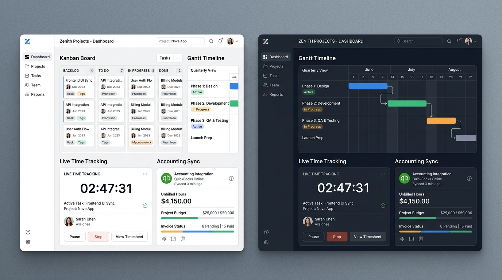

# Kopilot Projects – Collaborative Project Management & Accounting Hub



> An enterprise-grade, GDPR-compliant collaborative project management platform built for agile delivery teams, consultancies, and digital agencies. Features multi-view sprint tracking (Kanban, Gantt, and tabular list), precision billable time tracking, Slack real-time notifications, Google Drive file management, and direct WebAPI v1 synchronization with **Boekhoudgemak (Exact)** accounting.

---

## 🌟 Key Features

### 1. Real-Time Collaboration & Peer Presence
- **Live Collaborator Pulse**: Instant visual indicators showing active team members, currently viewed sections, and real-time task editing statuses.
- **Optimistic State Updates**: Seamless drag-and-drop task movements and status transitions across sprint columns.
- **In-App Notification Center**: Instant alert feed with unread counters, category filtering, and sound chimes for task completions and accounting batches.

### 2. Multi-View Workspace
- **Interactive Kanban Board**: 5-stage sprint workflow (Backlog, To Do, In Progress, Review, Completed) with unboxed clean metadata, priority tags, billable rate markers, and 1-click status transitions.
- **Gantt Milestone Timeline**: Interactive project phase scheduling across multi-week horizons with milestone flags, progress completion sliders, and critical delivery paths.
- **High-Density Task Grid**: Tabular view optimized for fast sorting, batch actions, assignee audits, and single-click CSV data exports.

### 3. Precision Time Tracking & Timesheets
- **Global & Task Stopwatch**: Persistent live timer in the top navigation bar with play, pause, resume, and stop controls.
- **Weekly Timesheet Matrix**: Day-by-day 7-day breakdown of logged hours with billable ratio calculation.
- **Manual Time Entry**: Fast dialog for logging historical hours with project attribution and client rate calculations.

### 4. Direct Boekhoudgemak (Exact) Accounting Synchronization
- **WebAPI v1 Direct Integration**: Built against `api.boekhoudgemak.nl/v1` (with sandbox testing against `sandbox-api.boekhoudgemak.nl/v1`).
- **Debtor & Project Mapping**: Connect project codes with Boekhoudgemak debtor relations (`DebtorCode`, e.g. `DEB-8041`).
- **Concept Sales Invoices (*Concept Verkoopfacturen*)**: Automatically package unbilled billable hours into draft sales invoice batches with line-item descriptions, default article codes (`UUR-DEV`), and ledger accounts (`8000`).
- **Full Audit Trail**: Inspect detailed JSON payloads, HTTP 201 Created responses, and transaction timestamps.

### 5. Slack & Google Drive Integrations
- **Slack Incoming Webhooks**: Automated notification broadcasts to channels (e.g. `#dev-team`, `#billing`) upon task completions, milestone deadlines, and invoice generation.
- **Google Drive File Hub**: Link Google Docs, Sheets, and design files directly to tasks with interactive file picking, cloud storage indicators, and quick external links.

### 6. GDPR / AVG Compliance & Data Privacy
- **Consent Preference Center**: Granular cookie banner categorizing Strictly Necessary, Productivity Analytics, and External Cloud Integrations.
- **Article 20 (Right to Data Portability)**: One-click export of a standardized machine-readable JSON archive containing all user projects, tasks, time logs, and audit trails.
- **Article 17 (Right to Erasure)**: Dedicated workflow to permanently purge personal workspace data.
- **Data Processing Addendum (DPA)**: Standardized EU-GDPR security compliance posture.

### 7. Multilingual & Dual-Theme UI
- **English Default with Instant Dutch (Nederlands) Toggle**: Comprehensive i18n dictionary covering every UI string, status, and accounting term.
- **Tailwind CSS v4 Dark & Light Modes**: Seamless visual contrast configured with `@custom-variant dark`.

---

## 🛠️ Technology Stack

- **Framework**: React 19 SPA with TypeScript
- **Styling**: Tailwind CSS v4 with custom dark mode variants and `@import "tailwindcss";`
- **Icons**: Lucide React
- **Animations & Transitions**: CSS transitions + smooth backdrop filters
- **Typography**: Plus Jakarta Sans & JetBrains Mono (via Google Fonts)
- **Bundler & Dev Server**: Vite 8 & TSX

---

## 🚀 Getting Started

### Prerequisites
- Node.js 20+
- npm or yarn

### Installation & Run

```bash
# Clone the repository
git clone <repo-url>
cd kopilot-projects

# Install dependencies
npm install

# Start development server on port 3000
npm run dev
```

Visit `http://localhost:3000` in your browser.

---

## 🔌 Boekhoudgemak WebAPI Configuration

To connect your Boekhoudgemak administration:

1. Open **Integrations Hub** from the left navigation and select the **Boekhoudgemak (Exact)** tab.
2. Select your environment:
   - **Production**: `https://api.boekhoudgemak.nl/v1`
   - **Sandbox**: `https://sandbox-api.boekhoudgemak.nl/v1`
3. Enter your **Administration Code** (e.g. `ADM-0042-NL`) and your **API Key / Bearer Token**.
4. Configure default ledger codes (e.g. `8000` for revenue) and default article codes (e.g. `UUR-DEV`).
5. Click **Test API Handshake** to verify connectivity.
6. Under **Unbilled Hours Staging**, click **Push Staged Hours to Boekhoudgemak** to generate draft invoices.

---

## 🔒 GDPR / AVG Privacy Principles

Kopilot Projects adheres strictly to the EU General Data Protection Regulation (AVG in the Netherlands):
- **Local Storage Isolation**: Personal tokens and workspace entries are safely cached client-side without third-party ad tracking.
- **Portability**: Export all your data at any time in standard JSON via **Privacy & GDPR > Export Personal Data**.
- **Erasure**: Permanently purge all local workspace state via **Privacy & GDPR > Purge Workspace Data**.

---

## 📄 License

Licensed under the Apache-2.0 License.
